<div align="center">


<br/>

[](https://linkedin.com/in/theodorutvik)
[](mailto:theodor.utvik@gmail.com)


</div>

<br/>

<div align="center">
  
</div>

###  &nbsp;whoami

```python
class Theodor:
    role       = "Applied AI Engineer @ Codeaco"          # building legal AI tools
    studying   = "M.Sc. Data Science for Business @ BI"   # 2026 – 2028
    background = "B.E. Computer Science, Programming & Cybersecurity @ NTNU"
    teaching   = "Learning assistant, software engineering & programming @ NTNU"
    side_quest = "Deputy leader @ Econa BI"

    route = ["Drammen", "Shanghai", "Busan", "Tønsberg", "Manila", "Gjøvik", "Oslo"]

    def philosophy(self):
        return "Overfit on curiosity. Regularise with coffee."
```

<br/>

###  &nbsp;Featured builds

<table>
<tr>
<td width="50%" valign="top">

####  &nbsp;[FPL Intelligence](https://github.com/TheodorUtvik/fpl-intelligence)
Predicts Fantasy Premier League points for every player, then lets **integer linear programming** pick the best squad and transfers under real FPL rules.

`MAE 0.75` · `R² 0.61` · `400+ players` · **retrains itself** after every gameweek via GitHub Actions

<sub>XGBoost · SHAP · Optuna · PuLP · Dash · aiohttp</sub>

</td>
<td width="50%" valign="top">

####  &nbsp;[Expo Vestfold Event Manager](./assets/expov-plakat.png)
A production event platform that replaced a legacy desktop tool. Cascading run-of-show scheduling and a **real-time multi-user view** for the crew on show day.

`live in production` · `CRM` · `real-time collaboration`

<sub>Next.js · TypeScript · Supabase · Vercel</sub>

</td>
</tr>
<tr>
<td width="50%" valign="top">

####  &nbsp;[Medicare Fraud Prediction](https://github.com/TheodorUtvik/predictive-modelling)
Which US Medicare providers will be excluded for fraud within three years, judged only by how they bill today? Rolling validation folds, bootstrap CIs, fairness checks, and a **lockbox opened exactly once**.

`2013 – 2022 panel` · `leakage audited`

<sub>scikit-learn · pandas · pytest</sub>

</td>
<td width="50%" valign="top">

####  &nbsp;[Padel Analytics](https://github.com/TheodorUtvik/padel-analytics)
Scrapes pro padel matches, engineers 33 pre-match features (ELO, pair chemistry, head-to-head, form streaks) and serves win probabilities for any two pairs.

`75.4% accuracy` · `+11 pp over ELO baseline`

<sub>XGBoost · scikit-learn · Streamlit</sub>

</td>
</tr>
</table>

<br/>

###  &nbsp;Toolbox

<div align="center">
  
</div>

<br/>

###  &nbsp;Contributions, eaten

<div align="center">

<!-- Generated by .github/workflows/snake.yml; appears after the workflow has run once -->
<picture>
  <source media="(prefers-color-scheme: dark)" srcset="https://raw.githubusercontent.com/TheodorUtvik/TheodorUtvik/output/github-snake-dark.svg" />
  
</picture>

</div>

<details>
<summary><b> &nbsp;Fun facts (click me)</b></summary>
<br/>

- Spent four years behind the counter at a bubble-tea shop. A Saturday rush is basically a constraint solver.
- My FPL model has opinions about your captain pick. It's usually right. My actual FPL rank is… a separate matter.
- Studied cybersecurity, so I will notice the API key you just committed.

</details>

<div align="center">

<br/>

**Got an ambitious idea where AI solves a real problem? Let's talk.**

[LinkedIn](https://linkedin.com/in/theodorutvik) · [Email](mailto:theodor.utvik@gmail.com) · [Portfolio](https://github.com/TheodorUtvik/portfolio)


</div>
